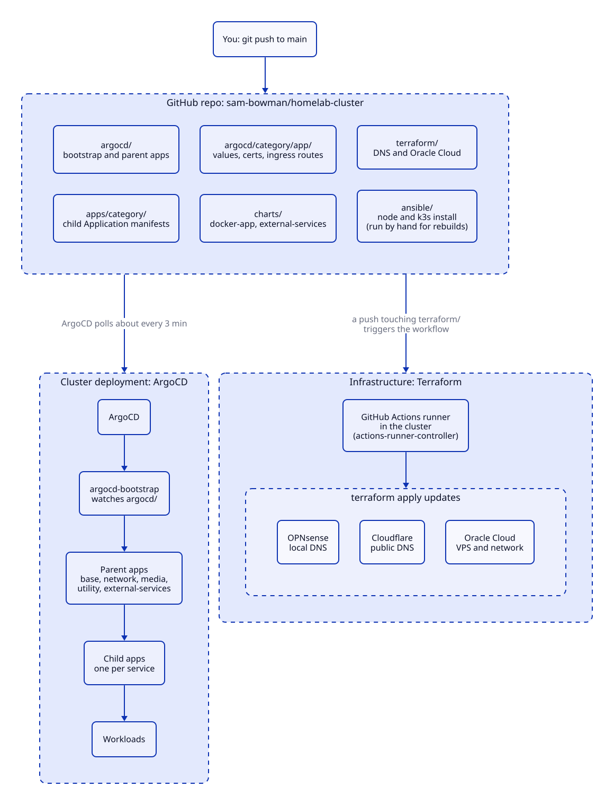
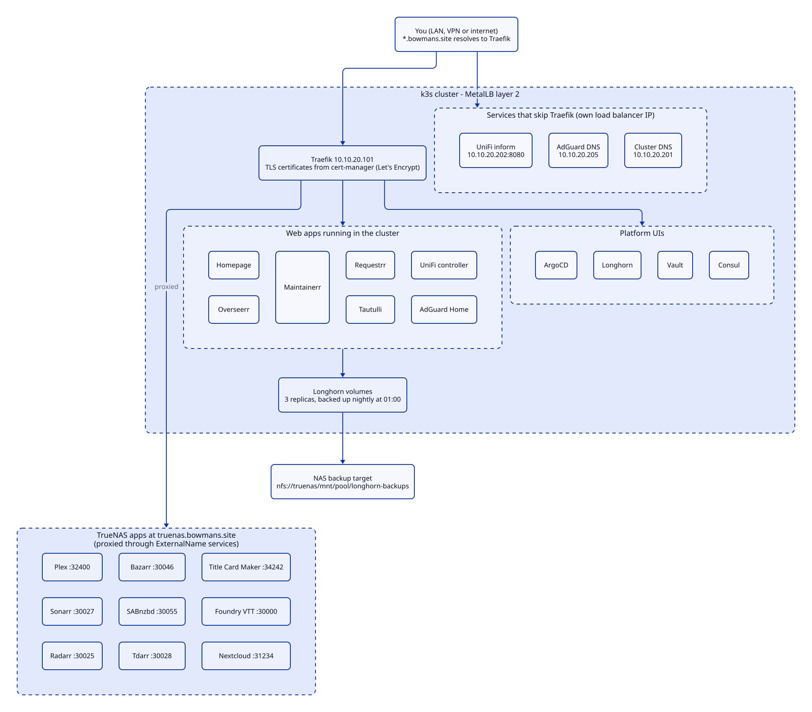
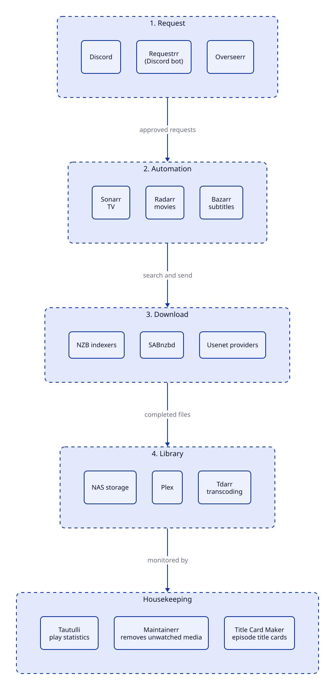
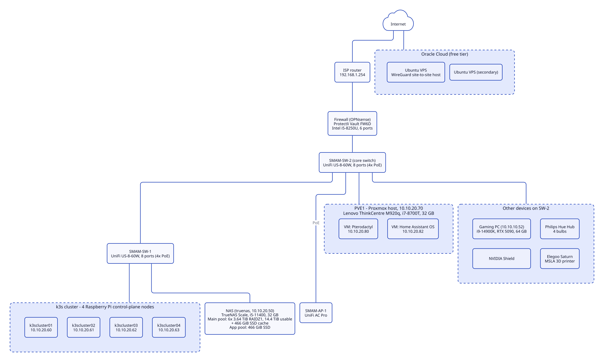
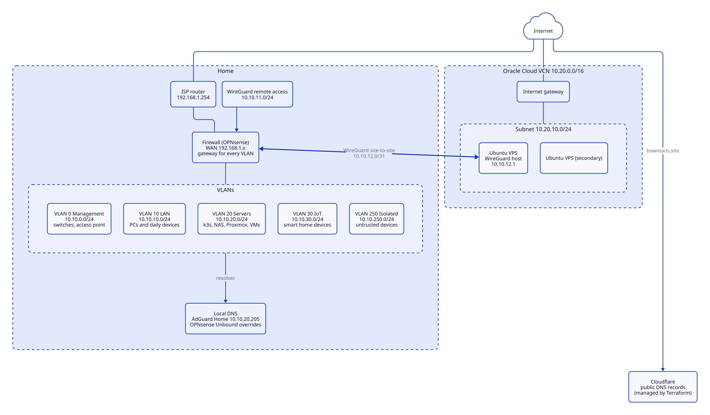

# homelab-cluster

Configuration for my homelab: a four-node k3s cluster on Raspberry Pis, managed with GitOps through ArgoCD, plus the Terraform that manages DNS and my Oracle Cloud VPS. The cluster watches this repository, so a push to `main` is the deployment.

It is written for my own network, but the layout should be easy to adapt. IP addresses, domain names and hardware are specific to my setup.

## At a glance

| | |
|---|---|
| Cluster | k3s, 4 control-plane nodes (Raspberry Pi), embedded etcd |
| Deployment | ArgoCD, app-of-apps, automated sync with pruning |
| Ingress | Traefik (bundled with k3s) at `10.10.20.101`, TLS from cert-manager and Let's Encrypt |
| Load balancing | MetalLB layer 2: `10.10.20.101-200` assigned automatically, `201-220` reserved for fixed IPs |
| Storage | Longhorn (3 replicas), nightly backup to the NAS over NFS |
| Secrets | Vault (Consul storage) with External Secrets; `vault-unsealer` unseals after a restart |
| DNS | AdGuard Home and OPNsense Unbound locally, Cloudflare publicly, all records in Terraform |
| CI | Self-hosted GitHub Actions runner in the cluster runs Terraform |
| Upgrades | `system-upgrade-controller` upgrades k3s from the plans in this repo |

## How changes are deployed



1. You push to `main`.
2. ArgoCD polls the repo about every 3 minutes. `argocd-bootstrap` watches `argocd/`, which holds the parent apps (`base`, `network`, `media`, `utility`, `external-services`) plus `argocd` (ArgoCD managing itself) and `all-limit-ranges`.
3. Each parent app watches its own folder under `apps/` and creates one child Application per file.
4. Each child Application deploys a Helm chart, plain manifests, or both, using the files under `argocd/<category>/<app>/`.
5. Pushing under `terraform/` also runs the Terraform workflow on the in-cluster runner.

All parent and child apps use automated sync with `prune: true`. Deleting a file deletes what it deployed, including volumes created by that app's chart.

## Repository layout

```
apps/                      Application manifests, one folder per category
  base/                      core cluster pieces (coredns, longhorn, metallb, traefik, upgrade controller)
  network/                   adguard, unifi
  media/                     overseerr, requestrr, tautulli, maintainerr
  utility/                   cert-manager, consul, vault, external-secrets, homepage, github-arc, ...
  external-services/         Helm chart: one Application per entry in values.yaml, for apps that run outside the cluster
argocd/
  app-*.yaml                 bootstrap parent apps (path: apps/<category>)
  argocd/                    ArgoCD itself: install manifest, repo credentials, ingress
  all-limit-ranges/          Helm chart: a default-requests LimitRange for each namespace listed in values.yaml
  <category>/<app>/          what each app deploys: values/values.yaml, cert.yaml, ingressroute.yaml, ...
charts/
  docker-app/                generic chart for a container image that has no chart of its own
  external-services/         ExternalName service, ingress route and certificate for a proxied app
terraform/                   DNS records (OPNsense, Cloudflare) and Oracle Cloud
ansible/                     node setup and k3s install, used for rebuilds
diagram/                     D2 sources and rendered SVGs for the diagrams in this file
scripts/                     small helper scripts
.github/workflows/           Terraform plan, apply and module validation
```

Two folders per app can look redundant. `apps/<category>/app-x.yaml` is the ArgoCD Application (what to deploy and where). `argocd/<category>/x/` holds the files that Application points at. They are separate on purpose: a parent app only reads the first, so moving manifests never changes which apps exist.

## What runs where



**In the cluster**

| Area | Apps |
|---|---|
| Platform | ArgoCD, Traefik, MetalLB, Longhorn, cert-manager, CoreDNS, k3s upgrade controller, GitHub Actions runner controller |
| Secrets | Vault, Consul (Vault's storage), External Secrets, Secrets Store CSI driver, vault-unsealer |
| Network | AdGuard Home, UniFi controller |
| Dashboard | Homepage |
| Media | Overseerr, Requestrr, Tautulli, Maintainerr |

**On the NAS, proxied through the cluster**

Plex, Sonarr, Radarr, Bazarr, SABnzbd, Tdarr, Title Card Maker, Foundry VTT and Nextcloud run as TrueNAS apps. Each gets an ExternalName service, an ingress route and a certificate from `charts/external-services`, so they share the same hostnames and TLS as everything else.

### Media flow



## Hardware and network





## Common tasks

### Add an app that runs in the cluster

Create `apps/<category>/app-<name>.yaml`, copying an existing one such as `apps/media/app-tautulli.yaml`. The `docker-app` chart takes the image, ports, volumes and a `resources.requests` block as Helm values. The parent app picks the file up on its next sync.

### Add an app that runs elsewhere

Add an entry to `apps/external-services/values.yaml` with a `name` and `port`. Add a `title` as well to get a Homepage tile (the widget expects `HOMEPAGE_VAR_<NAME>_API_KEY` in Vault). The target host defaults to `truenas.bowmans.site`; set `externalName` to point somewhere else. The chart in that folder renders one ArgoCD Application per entry.

### Add a hostname

Add an entry to `terraform/_locals.tf`, usually with `alias_of = "traefik"`. A push under `terraform/` creates the local and Cloudflare records.

### Give a namespace default resource requests

Add it to `namespaces` in `argocd/all-limit-ranges/values.yaml`, with an optional `cpu` or `memory` override. A LimitRange only applies to pods created after it exists, so restart existing pods to pick it up. `longhorn-system` is left out on purpose: it runs about 50 containers without requests, and a default would reserve around 5 cores and 5 GiB.

### Remove an app

Delete its file in `apps/<category>/` and its folder in `argocd/<category>/`. ArgoCD prunes everything it deployed. Namespaces created by the app stay behind, so delete them by hand once you are sure. Remove its DNS entry from `terraform/_locals.tf` as well.

### Upgrade a Helm chart

`scripts/helm_check_for_updates` lists newer chart versions and offers to update the files. Do not apply every bump blindly. A new chart can change labels, selectors, mount paths or default image versions. Read the chart's release notes, render it with `helm template`, and compare with the live resources first. Take a backup of anything with data.

### Upgrade k3s

Change `version` in both plans in `argocd/base/k3s-upgrade-controller/upgrade-plan.yaml`. The upgrade controller cordons and upgrades one control-plane node at a time, then the agents.

### Unseal Vault

Vault seals itself whenever a pod restarts. `vault-unsealer` (`argocd/utility/vault/unsealer.yaml`) watches both Vault pods and unseals them from the `vault-unseal-keys` secret. The secret is not in git. Create it with:

```bash
bash scripts/vault-create-unseal-secret.sh
```

The script prompts for three unseal keys with hidden input. Keep your other shares somewhere offline.

### Rebuild the cluster

1. Run the Ansible playbooks in order against the inventory in `ansible/00-inventory.yaml`: `01-initial-config`, `02-install-k3s`, `03-install-baseapps`. They prepare the nodes, install k3s, and apply MetalLB, the Traefik config and CoreDNS.
2. Install ArgoCD from `argocd/argocd/install.yaml` and apply `repos.yaml` and `app.yaml` from the same folder. From there ArgoCD manages itself and everything else.
3. Recreate the `vault-unseal-keys` secret, then unseal Vault and restore its data.

### Regenerate the diagrams

The D2 sources carry their own theme and layout settings, so each one renders with one command:

```bash
cd diagram
d2 hardware.d2 hardware.svg
d2 network.d2 network.svg
d2 gitops.d2 gitops.svg
d2 applications.d2 applications.svg
d2 media.d2 media.svg
```

## Things worth knowing

- **Traefik is owned by k3s.** The Deployment and Service come from k3s's own Helm chart, and the repo only holds the `HelmChart`, `HelmChartConfig` and middleware. Do not add a Traefik Deployment or Service here. The `traefik` app is manual-sync for that reason.
- **UniFi is pinned to `v8.6.9`** and the `unifi-ext` service uses `externalTrafficPolicy: Local`. With the default policy every device appears to come from one node address and the switches never settle as connected.
- **Pinning matters for stateful apps.** UniFi's chart defaults to a much newer controller and a different data path. Check `values.yaml` before bumping its chart.
- **Vault and Consul are linked.** Vault stores its data in Consul. Back both up before touching either.
- **Some drift is expected.** Parent apps ignore finalizers on child Applications, and a few apps ignore fields that the cluster fills in itself (CRD defaults, the UniFi load balancer address).
- **Secrets stay out of git.** Application secrets live in Vault and reach pods through External Secrets. The only secret created by hand is `vault-unseal-keys`.
